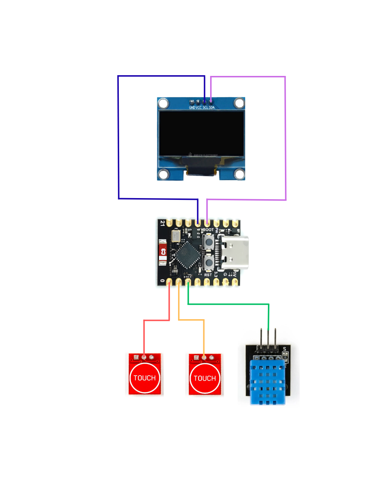

# 🤖 PIKO V1.4 - Desktop Mochi Robot

**PIKO** adalah robot meja (*desktop pet*) interaktif berbasis mikrokontroler ESP32-C3. Robot ini memiliki ekspresi wajah animasi yang dinamis dengan fisik mata berbasis kalkulasi fisika (interpulasi/spring), respon ekspresi terhadap usapan (*swipe touch*), pendeteksi suhu dan kelembaban udara, sinkronisasi jam NTP via WiFi, serta fitur *sleep mode*.

---

## 📌 Fitur Utama

- **Ekspresi Wajah Dinamis & Animasi Fisika:**
  - Animasi pergerakan mata yang halus.
  - Berbagai mode ekspresi (*Normal, Happy, Pleased, Sleepy*).
  - Melirik ke kiri dan kanan berdasarkan interaksi sentuhan.
  - Kedipan mata otomatis.
- **Interaksi Sentuh (Touch Gesture):**
  - **Single Touch (Kiri/Kanan):** Robot menengok ke arah sentuhan.
  - **Swipe Gesture (Elusan):** Mengelus sensor sentuh 3 kali mengaktifkan ekspresi *Pleased* (senang/keenakan) dengan ikon animasi hati.
  - **Hold Double Touch:** Menekan kedua sensor sentuh secara bersamaan untuk berpindah ke halaman **Information Mode**.
- **Mode Informasi System (Info Page):**
  - Menampilkan Jam & Tanggal (*Real-Time*) yang tersinkronisasi via NTP Server secara otomatis.
  - Menampilkan suhu ($^\circ\text{C}$) dan kelembaban udara ($\%$) dari sensor DHT11.
- **Sleep & Wake Up Mechanism:**
  - Masuk ke mode tidur otomatis setelah durasi inaktif (*timeout*).
  - Efek animasi *Zzz* melayang dan animasi pernapasan saat tidur.
  - Bangun otomatis saat sensor sentuh disentuh kembali.

---

## 🛠️ Komponen Hardware

| Komponen | Deskripsi |
| :--- | :--- |
| **ESP32-C3** | Mikrokontroler utama dengan WiFi terintegrasi |
| **OLED SH1106 1.3"** | Layar display resolusi $128 \times 64$ (I2C) |
| **TTP223** | 2x Sensor Sentuh Kapasitif (Touch Button Kiri & Kanan) |
| **DHT11** | Sensor Suhu dan Kelembaban Udara |

---

## 🔌 Skema Pinout / Wiring Diagram

Berikut adalah petunjuk sambungan pin hardware berdasarkan skema rangkaian:



| Komponen | Pin Komponen | Pin ESP32-C3 |
| :--- | :--- | :--- |
| **OLED SH1106** | SDA | **GPIO 8** |
| | SCL | **GPIO 9** |
| | VCC | 3.3V / 5V |
| | GND | GND |
| **Touch Kiri (0)** | OUT | **GPIO 0** |
| | VCC / GND | 3.3V / GND |
| **Touch Kanan (1)** | OUT | **GPIO 1** |
| | VCC / GND | 3.3V / GND |
| **Sensor DHT11** | DATA (S) | **GPIO 2** |
| | VCC / GND | 3.3V / GND |

> **Catatan:** Simpan gambar diagram rangkaian Anda dengan nama `wiring.png` di folder proyek yang sama pada repositori GitHub agar gambar di atas dapat tampil dengan benar.

---

## 📚 Library yang Dibutuhkan

Sebelum melakukan *compile* dan *upload* kode, pastikan Anda telah menginstal pustaka berikut melalui **Library Manager** di Arduino IDE:

1. **Adafruit GFX Library** (`Adafruit_GFX.h`)
2. **Adafruit SH110X** (`Adafruit_SH110X.h`)
3. **DHT sensor library** oleh Adafruit (`DHT.h`)

---

## 🚀 Cara Penggunaan

1. Download atau clone repositori ini:
   ```bash
   git clone https://github.com/username/piko-mochi-robot.git
   ```
2. Buka berkas `.ino` menggunakan **Arduino IDE**.
3. Cari bagian konfigurasi WiFi pada bagian atas kode:
   ```cpp
   const char* WIFI_SSID = "Nama Wifi Kamu";   
   const char* WIFI_PASSWORD = "Pasword Wifi Kamu"; 
   ```
   Ubah `"Nama Wifi Kamu"` dan `"Pasword Wifi Kamu"` sesuai dengan kredensial WiFi Anda.
4. Pilih Board **ESP32C3 Dev Module** pada Arduino IDE.
5. Lakukan **Upload** ke board ESP32-C3 Anda.

---

## 📄 Lisensi

Proyek ini bersifat open-source di bawah lisensi [MIT License](LICENSE). Anda bebas untuk mengembangkan, memodifikasi, dan membagikan ulang proyek ini.